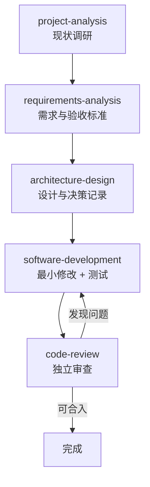

# Skills 创建、验证与维护指南

> 本仓库的 Skills 遵循 [Agent Skills 开放规范](https://agentskills.io/specification)。
> 唯一源文件在 `skills/`；`adapters/` 与安装目标目录中的副本都由 `install.py` 生成，**不要直接编辑副本**。

---

## 0. 官方规范核实结果

**核实日期**：2026-11-11
**官方来源**：[A] [agentskills.io/specification](https://agentskills.io/specification)（格式规范）；
[A] [agentskills.io/what-are-skills](https://agentskills.io/what-are-skills)（概览与渐进式加载）。
本节结论均以当日官方页面为准；若规范更新，以当前官方规范为准并同步修订本表与校验器。

| # | 核实项 | 官方要求（当日） | 本仓库落实 |
| --- | --- | --- | --- |
| 1 | `SKILL.md` 文件结构 | 技能是目录，至少含 `SKILL.md`（元数据 + 指令）；可选 `scripts/` `references/` `assets/` | 一致，见 §4 |
| 2 | YAML Frontmatter | 文件首行 `---`，YAML 后接 Markdown 正文 | `validate.py` 校验，见 §1 |
| 3 | `name` 规则 | 必填；1–64 字符；仅小写字母/数字/连字符；不以 `-` 首尾；无连续 `--`；**须等于目录名** | 一致，见 §1 |
| 4 | `description` 规则 | 必填；1–1024 字符；非空；应同时说明「做什么」与「何时用」，含便于识别任务的关键词 | 加触发词与排除场景，见 §2 |
| 5 | 可选字段及限制 | `license`；`compatibility`（≤500 字符）；`metadata`（string→string 映射）；`allowed-tools`（**实验性**，空格分隔字符串） | 仅用 6 字段白名单，见 §1 |
| 6 | 目录结构 | 目录可含任意文件；`scripts/` `references/` `assets/` 为约定用法 | 五个 Skill 用 `references/`+`assets/`，见 §4 |
| 7 | 资源引用方式 | 相对技能根目录的路径，如 `references/REFERENCE.md`；保持**一级深度**，避免深层链 | `validate.py` 强制一级+存在性，见 §4 |
| 8 | 渐进式加载 | 三层：① 元数据（约 100 tokens，启动时加载 name/description）② 完整 `SKILL.md` 正文（建议 < 5000 tokens，激活时加载）③ 资源（按需加载）。概览页表述为 Discovery → Activation → Execution 三阶段 | 正文内联红线、细节入 `references/`，见 §4 |
| 9 | 大小/内容限制 | `SKILL.md` **保持 < 500 行**；正文无格式限制，建议含分步指令、输入输出示例、常见边界 | `validate.py` 强制 < 500 行，正文 143–171 行 |
| 10 | 脚本 / 参考 / 资源要求 | `scripts/` 自包含或写明依赖、含清晰报错、优雅处理边界；`references/` 每文件聚焦单主题、按需加载；`assets/` 放模板与静态资源；官方提供 `skills-ref validate` 参考校验器 | 见 §4；`skills-ref` 未集成（零依赖约束），见下方待验证 |

**能力边界**：工具扩展字段（如 Claude Code 的 `paths`/`hooks`/`model`、Cursor 的 `icon`/`color`）
是特定产品的扩展，**不属于**开放标准字段，一律放在 `adapters/`，不污染公共 Skill（见 §1）。

> ⚠️ **待验证**：官方 [`skills-ref`](https://github.com/agentskills/agentskills/tree/main/skills-ref)
> 校验器的额外检查项。本仓库以自建等价校验替代，受「零第三方依赖」约束未集成该工具，
> **不宣称**两者结果完全一致。见 [tool-adapters.md](tool-adapters.md) §1。

---

## 1. 规范硬约束（可被 `validate.py` 检查）

| 项 | 约束 | 违反时的级别 |
| --- | --- | --- |
| 目录结构 | `<skill-name>/SKILL.md` | ERROR |
| Frontmatter | 文件第一行必须是 `---`，YAML 后接 Markdown 正文 | ERROR |
| `name` | 必填；1–64 字符；`^[a-z0-9]+(?:-[a-z0-9]+)*$`；无首尾 `-`、无连续 `--`；**等于目录名** | ERROR |
| `description` | 必填；1–1024 字符；非空 | ERROR |
| `description` 质量 | 需同时体现「做什么」和「何时用」，含明确触发词 | WARNING |
| 字段白名单 | 只允许 `name` / `description` / `license` / `compatibility` / `metadata` / `allowed-tools` | ERROR |
| `compatibility` | 若提供，≤ 500 字符 | ERROR |
| `metadata` | 若提供，必须是 string→string 映射 | ERROR |
| `allowed-tools` | 若提供，必须是字符串 | ERROR |
| 正文 | 非空；不含占位符（`TODO` / `待补充` / `TBD`）；**< 500 行** | ERROR |
| 必需章节 | 触发场景、适用范围、执行步骤、输入、输出、质量检查、完成标准、异常处理 | ERROR |
| 文件引用 | 相对技能根目录，一级深度，目标必须存在 | ERROR |
| 资源目录 | 仅 `scripts/` / `references/` / `assets/`（或 `templates/`，见 §4） | WARNING |

**字段白名单的理由**：Claude Code 的 `paths`、`hooks`、`model`，Cursor 的 `icon`、`color`
等是工具扩展字段，写进统一源会破坏工具无关性，且会在上传到 claude.ai /
Skills API 时因 `Unexpected key(s) in SKILL.md frontmatter` 失败。
详见 [tool-adapters.md](tool-adapters.md) §1、§3。

> ⚠️ **待验证**：官方 `skills-ref` 校验器的额外检查项。本仓库用自建等价校验代替，
> 不宣称两者结果完全一致。见 [tool-adapters.md](tool-adapters.md) §1。

---

## 2. 创建一个新 Skill

```bash
cd ai-engineering-standards
mkdir -p skills/my-skill
cp tooling/templates/SKILL.md.template skills/my-skill/SKILL.md
# 编辑 name / description / 全部占位段落（模板中的 <> 必须替换干净）
python tooling/scripts/validate.py
```

模板在 [tooling/templates/SKILL.md.template](../tooling/templates/SKILL.md.template)。
一份合规的最小 Frontmatter：

```yaml
---
name: my-skill
description: 检查数据库迁移脚本的幂等性与回滚路径。Use when 新增或修改 schema migration、评审包含 DDL 的 PR，或用户提到「迁移回滚」「数据兼容」时。
license: MIT
metadata:
  owner: ai-engineering-standards
  version: "1.0.0"
---
```

`description` 写法要点（触发可靠性完全取决于它）：

- **把关键用例和触发词放在最前面**：Codex 的初始技能列表有约 8,000 字符预算，
  会优先缩短描述；Claude Code 在 1,536 字符处截断。
- 同时写「能力」与「触发场景」，包含用户真正会说出口的关键词。
- 明确写出**不**该触发的场景，避免误命中。
- 反例：`description: 帮助处理数据库。` —— 没有能力、没有触发词、没有关键词。

---

## 3. 正文结构（每个 Skill 必须能独立理解和执行）

正文采用「8 个校验器强制章节 + 2 个本项目要求章节 + 可选参考资料」的结构，
让 AI 无需猜测即可独立执行。8 个强制章节缺一即由 `validate.py` 报 ERROR；
「何时不使用」「与其它 Skill 配合」为本仓库在 Agent Skills 开放格式之上追加的质量要求
（不写入 Frontmatter，不违反官方规范），由本阶段临时检查脚本核对：

| 章节 | 强制性 | 内容要求 |
| --- | --- | --- |
| 前置约束（内联红线） | 推荐 | 仅摘录本任务真正需要的 3–6 条 core 红线，不整篇复制 |
| 触发场景 | ERROR | 列出 3–6 条具体情境与典型用户表述 |
| **何时不使用** | 本项目要求 | 明确排除场景 + 改用哪个 Skill + 判断依据，避免误命中 |
| 适用范围 | ERROR | 输入边界、权限边界（例如只读 / 可写）、不适用的项目类型 |
| **与其它 Skill 配合** | 本项目要求 | 上游输入、下游消费、运行时依赖、典型组合；声明**无强制运行时依赖** |
| 执行步骤 | ERROR | 编号、命令式、每步有可观察的产出；不依赖 AI 猜测未定义的规则 |
| 输入要求 | ERROR | 必需输入 / 可选输入 / 缺失时如何处理 |
| 输出要求 | ERROR | 结构化产物（段落名、字段、格式），必要时指向 `assets/` 中的模板 |
| 质量检查 | ERROR | 可逐条勾选的检查项；能自动化的给出命令 |
| 完成标准 | ERROR | 明确「满足什么才算做完」，避免模糊的「已完成」 |
| 异常情况处理 | ERROR | 输入缺失、项目结构异常、工具不可用、权限不足、结论不确定时分别怎么办 |
| 按需参考资料 | 可选 | 指向 `references/` 的一级相对链接；没有则在模板中注明可省略 |

此外，每份 `SKILL.md` 开头须声明**渐进加载**与**不假设能访问其它会话上下文**，
把 `core/` 通用原则、`standards/` 具体技术作为「按需查阅」项，关键红线内联（见 §4）。

**关键原则：Skill 不得要求 AI 去读一个不存在的文件、调用一个不存在的接口，
或默认某个未声明的依赖已经就绪。** 所有前置条件都写在「输入要求」里。

---

## 4. 控制篇幅：渐进披露

Agent Skills 的渐进式加载分三层（见 §0 核实项 8）：
**① 元数据**（name + description，约 100 tokens，启动时对所有 Skill 加载）→
**② 完整 `SKILL.md` 正文**（建议 < 5000 tokens，Skill 被激活时加载）→
**③ 资源**（`references/` `scripts/` `assets/`，仅在任务需要时按需加载）。
因此 description 决定「会不会被激活」，正文决定「激活后能不能独立执行」，
两者都要自包含，详细资料才下沉到资源层。

```
my-skill/
├── SKILL.md              # 概览 + 导航，< 500 行 / < 5000 tokens
├── references/           # 按需读取的详细资料，每个文件聚焦一个主题
│   ├── checklist.md
│   └── domain-notes.md
├── scripts/              # 可执行代码（自包含、有清晰报错、优雅处理边界）
│   └── check.py
└── assets/               # 模板 / 静态资源（原样使用或由 Agent 填充）
    └── report-template.md
```

- 拆分阈值：`SKILL.md` 超过约 200 行或出现大段清单/示例时，就移到 `references/`。
- 引用保持**一级深度**：正文中只写 `references/<topic>.md`、`assets/<name>.md`
  这类一级相对路径；不要写 `references/sub/deep/...`，也不要让参考文件再引用第三层文件。
- **`SKILL.md` 只允许引用打包在技能目录内的资源**（`references/` / `scripts/` /
  `assets/`）。**禁止**写 `../../core/xxx.md` 这类指向仓库其它目录的链接：
  安装后 Skill 位于 `<target>/.claude/skills/<name>/`、`.agents/skills/<name>/` 等位置，
  这类链接会失效。需要引用通用规范时，用**纯文本**写明项目根目录下的
  `.ai-standards/core/...`，并把关键红线**内联**到 SKILL.md 的「前置约束」章节。
- `scripts/` 中的脚本必须自包含或写清依赖，并给出可读的错误信息。
- 正文里的每条相对引用都会被 `validate.py` 检查是否存在。

> 注：规范的可选目录是 `scripts/ references/ assets/`。本仓库允许额外的
> `templates/` 用于输出模板，但会作为 WARNING 提示，优先使用 `assets/`。

---

## 5. 验证与分发

```bash
# 1. 只检查 Skills（Frontmatter / 命名 / 引用 / 章节 / 工具字段泄漏）
python tooling/scripts/validate.py --skills

# 1b. 全量仓库自检 + 严格模式（把明确的 WARNING 升级为 ERROR）
python tooling/scripts/validate.py --strict

# 2. 分发到已接入的项目（先看计划，再强制更新；覆盖前自动备份）
python tooling/scripts/install.py --all --dry-run --target /path/to/my-app
python tooling/scripts/install.py --all --force --target /path/to/my-app

# 3. 检查安装结果（含每个副本的 SHA-256、生成文件新鲜度）
python tooling/scripts/check.py --target /path/to/my-app

# 3b. 检查仓库内 Skills 一致性（源完整性 / 重复不一致副本 / 过期镜像副本）
python tooling/scripts/check.py --skills

# 4. 全量自动化测试（含 Skill 校验器单测）
python -m unittest discover -s tooling/tests -v
```

`validate.py --skills` 底层是 `tooling/validators/skill_validator.py`，它复用
`common.check_skill` 的同一套 Agent Skills 规范检查，并额外保证：公共 `skills/` 源文件不得含
`applyTo` / `alwaysApply` / `globs` / `paths` 等工具专有字段（否则破坏可移植性），
且每个 Skill 目录都已登记到 `targets.SKILL_NAMES`（否则安装器不会分发它）。

安装器会把 `skills/<name>/` 整个目录复制到：

| 工具 | 目标 |
| --- | --- |
| Codex | `.agents/skills/<name>/` |
| Claude Code | `.claude/skills/<name>/` |
| Cursor | `.cursor/skills/<name>/` |
| Copilot | `.github/skills/<name>/` |

四份副本内容**逐字节相同**，源只有一份；`manifest.json` 为每个文件记录 SHA-256。
不要用 `--force` 之外的手段修改副本。

---

## 6. 维护与废弃

| 场景 | 做法 |
| --- | --- |
| 修正措辞 / 补充步骤 | 只改 `skills/<name>/SKILL.md`，跑 `validate.py` + 分发 |
| 新增详细资料 | 放 `references/<topic>.md`，在 `SKILL.md` 加一级链接 |
| 拆分过大的 Skill | 新建目录 + 新 `name`，从旧 Skill 删除对应步骤并加「见 xxx」链接，写 CHANGELOG |
| 废弃 Skill | 先从 `CHANGELOG.md` 标记 Deprecated，保留至少一个版本周期；再从 `skills/` 移除并写迁移说明 |
| 修改 `name` | 必须同步改目录名；这是一次破坏性变更，按 [versioning.md](versioning.md) 提升主版本 |

`install.py` **不自动删除**目标项目中已不在源里的旧 Skill 副本，
只在报告中给 `WARNING: stale managed file`，由维护者按
[installation.md §11](installation.md) 手工清理。

---

## 7. 五个内置 Skill 的职责边界与组合方式

### 7.1 职责边界

| Skill | 只读 / 可写 | 主要产物 | 不做什么 |
| --- | --- | --- | --- |
| `project-analysis` | **只读** | 项目分析报告 | 不修改任何项目代码 |
| `requirements-analysis` | 只读（产出文档） | 结构化需求文档 + 待确认清单 | 不做技术选型、不写代码 |
| `architecture-design` | 只读（产出文档） | 架构设计文档 + 决策记录 | 不为用设计模式而引入抽象、不直接编码 |
| `software-development` | 可写 | 最小代码修改 + 测试 + 实施报告 | 不做未授权的大规模重构 |
| `code-review` | **只读** | 按严重程度排序的真实问题清单 | 不虚构问题凑数、不直接改代码 |

边界判定遵循「问题属于哪个阶段」：现状是什么 → 分析；要做什么/做到什么算完 → 需求；
怎么划模块/选方案 → 设计；落地与验证 → 实施；对不对/能不能合 → 审查。
边界重叠时**只读 Skill 优先**，且不得在只读 Skill 内实施写操作。

### 7.2 典型组合流程（非强制顺序）



这条链只是**复杂任务的一种典型工作流，不是执行顺序约束**。五个 Skill 彼此
**没有运行时依赖**，每个都能被单独调用并独立完成——这是「按需加载」的前提。
不得因为「上游 Skill 还没跑」就拒绝单独调用某个 Skill，也不得虚构缺失的上游产物。

### 7.3 何时跳过（按需选用）

| 场景 | 直接使用的 Skill | 跳过的环节 |
| --- | --- | --- |
| 只要求分析项目 | `project-analysis` | 其余全部 |
| 用户已给明确需求与验收标准 | `architecture-design` 或 `software-development` | 分析、需求 |
| 明确的 Bug 修复、小范围改动 | `software-development` | 分析、需求、设计 |
| 只要求审查一段改动 | `code-review` | 其余全部 |
| 复杂需求 / 陌生系统 | 按需组合多个 Skill | 视信息完备程度裁剪 |

组合由「信息是否完备、任务风险高低」决定，不由「流程完整性」决定。

### 7.4 每个 Skill 的六要素对照

| Skill | 何时使用 | 何时不使用 | 主要输入 | 执行步骤数 | 主要输出 | 与其它 Skill 配合 |
| --- | --- | --- | --- | --- | --- | --- |
| `project-analysis` | 接手陌生仓库、动手前摸现状 | 已掌握项目、要改代码或选型 | 可读取的项目目录 | 9 | 项目分析报告 | 无运行时依赖；报告可选作下游输入 |
| `requirements-analysis` | 需求模糊、验收口径不清 | 需求与验收已明确 | 用户原始需求 + 可选现状 | 8 | 需求文档 + 待确认清单 | 无运行时依赖；产物供设计/实施 |
| `architecture-design` | 新增模块、边界不清、技术选型 | 需求未明、仅最小改动 | 需求与验收 + 现状事实 | 10 | 设计文档 + 决策记录 | 无运行时依赖；缺输入则退回澄清 |
| `software-development` | 需求已明确、修 bug、补测试 | 需求模糊、需选型、要审查 | 需求与验收 + 实施边界 + 运行命令 | 10 | 代码/测试改动 + 实施报告 | 无运行时依赖；小改动可直达 |
| `code-review` | 提交前自检、PR/diff 审查 | 要实现、要澄清、要调研 | diff + 需求验收 + 项目规范 | 10 维度 | 分级问题清单 + 可合入结论 | 无运行时依赖；审查与实施分离 |

> 「执行步骤数」指各 `SKILL.md`「执行步骤」章节的编号步骤；`code-review` 为 10 个审查维度。
> 每份 Skill 的完整六要素以其 `SKILL.md` 为准，本表仅为选用速查。
